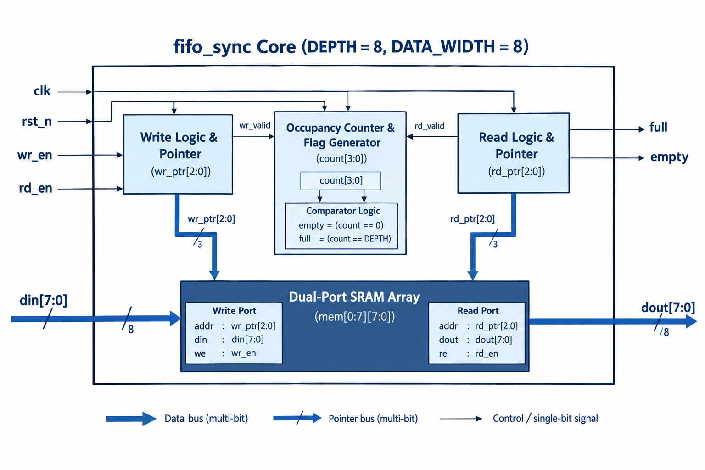
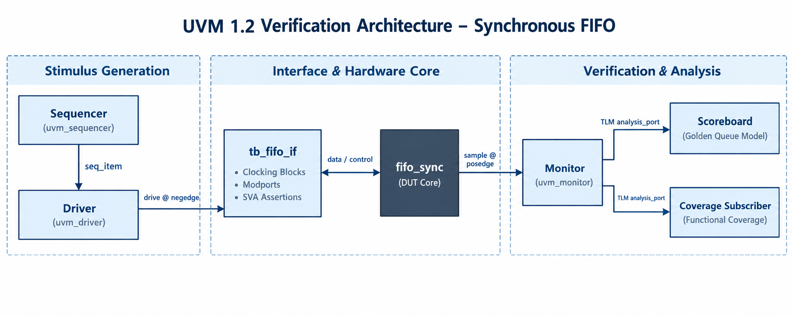
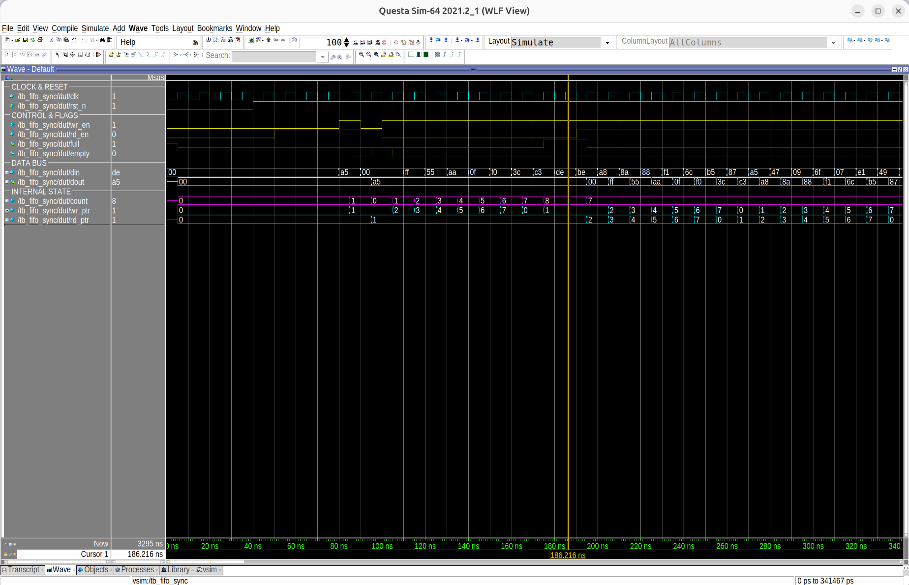

# 🚀 Parameterizable Synchronous FIFO Verification

### Production-Grade UVM 1.2 Testbench & 100% Coverage Closure

[](https://en.wikipedia.org/wiki/SystemVerilog)
[](https://accellera.org/downloads/standards/uvm)
[](https://eda.sw.siemens.com/en-US/ic/questasim/)
[](docs/verification_report.md)
[](LICENSE)

[📋 Verification Plan](docs/verification_plan.md) • [📊 Verification Report](docs/verification_report.md) • [🏗 Architecture](#-architecture) • [⚡ Key Highlights](#-key-engineering-challenges--solutions) • [💻 Quick Start](#-how-to-run) • [👨‍💻 Author](#author)

---

## 📌 Executive Summary

This repository hosts a complete, self-checking Universal Verification Methodology (**UVM 1.2**) environment for a parameterizable **Synchronous FIFO** (`fifo_sync`).

In modern System-on-Chip (SoC) designs, FIFOs are vital buffering elements. Undetected FIFO errors cause packet loss, buffer overflow, and data corruption. This project verifies the FIFO core against extreme corner cases, invalid protocol transfers, and random traffic stress, ultimately achieving **100% Code and Functional Coverage** in Siemens QuestaSim.

### 🎯 Verification Dashboard

| Metric | Target | Result | Status |
| :--- | :---: | :---: | :---: |
| **Simulation Result** | 0 Errors | **0 Errors / 0 Warnings** (338 UVM_INFO) | 🟢 **PASSED** |
| **Scoreboard Score** | 100% Match | **333 Transactions Checked (0 Mismatches)** | 🟢 **PASSED** |
| **Statement Coverage** | 100% | **100.00% (23 / 23 lines)** | 🟢 **CLOSED** |
| **Branch Coverage** | 100% | **100.00% (12 / 12 branches)** | 🟢 **CLOSED** |
| **Condition Coverage** | 100% | **100.00% (With verified waivers)** | 🟢 **CLOSED** |
| **Expression Coverage** | 100% | **100.00% (6 / 6 terms)** | 🟢 **CLOSED** |
| **Toggle Coverage** | 100% | **100.00% (68 / 68 nodes)** | 🟢 **CLOSED** |
| **Functional Coverage** | 100% | **100.00% (20 / 20 bins)** | 🟢 **CLOSED** |
| **SVA Assertions** | 100% | **100.00% (5 / 5 passed)** | 🟢 **PASSED** |

---

## 🏗 Architecture

### 1. Hardware Core (`fifo_sync.sv`)

The Design Under Verification (DUV) is a single-clock FIFO with circular pointers (`wr_ptr`, `rd_ptr`), an occupancy counter (`count`), and combinational status flags (`full`, `empty`).



### 2. UVM Testbench Environment

The verification testbench uses standard UVM component hierarchy and TLM (Transaction Level Modeling) analysis ports:



* **Agent:** Encapsulates `Sequencer`, `Driver`, and `Monitor`.
* **Driver:** Drives stimulus strictly on the falling clock edge (`negedge clk`) to ensure zero setup/hold timing hazards.
* **Monitor:** Samples pin activity on the rising clock edge (`posedge clk`) with a discrete delta-margin (`#1ps`).
* **Scoreboard:** Uses an associative golden reference queue (`logic [DATA_WIDTH-1:0] fifo_model[$]`) to verify strict first-in, first-out data ordering.
* **Coverage Subscriber:** Gathers functional coverage across operations, flags, and data patterns.

---

## 🔍 Waveform & Corner-Case Verification



### 💡 Notable Scenario: Simultaneous Read/Write when FULL

A critical test scenario happens around timestamp **186.2 ns**:
* **Initial State:** FIFO is completely full (`count = 8`, `full = 1`).
* **Input Stimulus:** Both `wr_en = 1` ($din = \text{0xBE}$) and `rd_en = 1` are requested simultaneously.
* **Hardware Protection:**
  $$write\_ok = wr\_en \ \&\&\ !full = 1 \ \&\&\ !1 = 0 \quad (\text{Write is REJECTED})$$
  $$read\_ok = rd\_en \ \&\&\ !empty = 1 \ \&\&\ !0 = 1 \quad (\text{Read is ACCEPTED})$$
* **Result:** The write is dropped to prevent memory corruption. The read succeeds, popping $00$ onto `dout`. The occupancy counter drops from $8 \rightarrow 7$, safely bringing `full` low.

---

## 💡 Key Engineering Challenges & Solutions

### 1. Race-Free Timing Synchronization
* **Problem:** Sampling combinational flags (`full`, `empty`) at `posedge clk` caused simulator delta-cycle race conditions, triggering false scoreboard mismatches.
* **Solution:** Drive inputs at `negedge clk` and sample outputs at `posedge clk` with a bounded delta-delay margin (`#1ps`), guaranteeing deterministic capture of registered outputs.

### 2. Coverage Closure via Mathematical Waivers (`waivers.do`)
* **Problem:** Focused Condition Coverage was stuck at 60% on RTL lines 59 and 78 (`if (rd_en && empty)`).
* **Solution:** Conducted Boolean truth-table analysis proving that inside `case 2'b10` and `default`, $read\_ok = 0$ strictly implies that when $rd\_en = 1$, $empty$ must equal $1$. Thus, the state $(rd\_en=1, empty=0)$ is mathematically unreachable. An automated waiver script (`waivers.do`) was created with formal justification.

### 3. Dynamic Runtime Reset Recovery
* **Problem:** Toggle coverage on `rst_n` missed the $1 \rightarrow 0$ transition (stuck at 98.52%).
* **Solution:** Enhanced the sequence with mid-stream reset pulses to verify pointer flushing, state recovery, and achieve 100% toggle coverage.

---

## 📁 Repository File Structure

```text
synchronous-fifo-uvm-verification/
├── .gitignore                      # Git exclusion rules (ignores sim artifacts)
├── config.mk                       # QuestaSim paths and compilation flags
├── Makefile                        # Automation recipes for build, sim & coverage
├── waivers.do                      # QuestaSim formal coverage waiver rules
├── rtl/
│   └── fifo_sync.sv                # Parameterizable Synchronous FIFO Core
├── tb/
│   ├── tb_fifo_if.sv               # Interface with Clocking Blocks & 5 SVA Assertions
│   ├── tb_fifo_transaction.sv      # UVM sequence item
│   ├── tb_fifo_sequence.sv         # CRV stimulus and corner-case sequences
│   ├── tb_fifo_sequencer.sv        # UVM sequencer
│   ├── tb_fifo_driver.sv           # Timing-accurate driver
│   ├── tb_fifo_monitor.sv          # Passive monitor
│   ├── tb_fifo_agent.sv            # Active UVM agent
│   ├── tb_fifo_scoreboard.sv       # Golden queue reference model
│   ├── tb_fifo_coverage.sv         # Functional covergroups and cross coverage
│   ├── tb_fifo_env.sv              # Top-level UVM environment
│   ├── tb_fifo_test.sv             # Test scenario configuration
│   ├── tb_fifo_sync_pkg.sv         # Package wrapper
│   └── tb_fifo_sync.sv             # Top-level simulation module
└── docs/
    ├── verification_plan.md        # Detailed Verification Plan (vPlan)
    ├── verification_report.md      # Full Verification & Coverage Closure Report
    ├── fifo_block_diagram.png      # Hardware block diagram
    ├── uvm_architecture.png        # UVM testbench architecture
    └── waveform_corner_cases.png   # Annotated waveform snapshot
```

---

## 💻 How to Run

### Prerequisites
* **Simulator:** Siemens QuestaSim / ModelSim (version 10.7 or newer recommended).
* **Environment:** Linux / WSL2 with `make` and `gcc` installed.

### Execution Commands

```bash
# 1. Clean previous simulation databases and temporary logs
make clean

# 2. Compile RTL, UVM testbench, and run simulation with full coverage
make all_cov

# 3. Apply waivers and generate text coverage reports
make gen_cov

# 4. Generate browsable HTML coverage report
make gen_html

# 5. Open interactive GUI waveform
make wave
```

### Viewing Coverage Reports
* **DUT Detailed Report:** `sim/coverage/dut_details.txt`
* **Overall Summary:** `sim/coverage/summary_report.txt`
* **HTML Browser Report:** Open `sim/coverage/covhtmlreport/index.html` in any web browser.

---

## 📚 Detailed Documentation Links

For in-depth technical analysis, inspect the dedicated documents in the `docs/` folder:
* 📋 [**Detailed Verification Plan**](docs/verification_plan.md): Complete specifications, test matrix, SVA definitions, and covergroup models.
* 📊 [**Verification & Coverage Closure Report**](docs/verification_report.md): Mathematical waiver proofs, full log extracts, and sign-off criteria.

---

<a id="author"></a>
<h2><strong>👨‍💻 Author</strong></h2>
<table>
  <tr>
    <td colspan="3" align="center">
      <br>
      <h2>⚡ Hoàng Ngọc Gia Bão</h2>
      <p><b>Integrated Circuit Design · FPT University</b></p>
      <br>
      <p><b>📬 Connect with me</b></p>
    </td>
  </tr>
  <tr>
    <td align="center" width="300">
      <br>
      <a href="mailto:baohoang037@gmail.com"></a>
      <p><a href="mailto:baohoang037@gmail.com">baohoang037@gmail.com</a></p>
    </td>
    <td align="center" width="300">
      <br>
      <a href="https://www.linkedin.com/in/hoang-ngoc-gia-bao-883124235/"></a>
      <p><a href="https://www.linkedin.com/in/hoang-ngoc-gia-bao-883124235/">View professional profile ↗</a></p>
    </td>
    <td align="center" width="300">
      <br>
      <a href="https://github.com/baohoang037"></a>
      <p><a href="https://github.com/baohoang037">@baohoang037 ↗</a></p>
    </td>
  </tr>
</table>